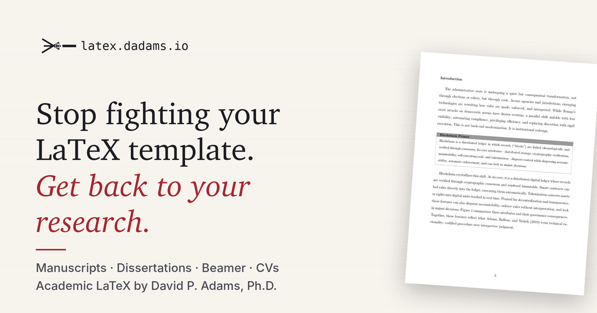

<p align="center">
  <a href="https://latex.dadams.io"></a>
</p>

<h1 align="center">latex.dadams.io</h1>

<p align="center">
  Academic LaTeX typesetting by David P. Adams, Ph.D.<br>
  <a href="https://latex.dadams.io"><strong>Visit the site</strong></a> ·
  <a href="https://latex.dadams.io/#samples">Samples</a> ·
  <a href="https://latex.dadams.io/#pricing">Pricing</a> ·
  <a href="https://latex.dadams.io/#contact">Get a quote</a>
</p>

---

This repository holds the source for **[latex.dadams.io](https://latex.dadams.io)**, a LaTeX typesetting service for academics in public administration, political science, and the social sciences. The work is done by an associate professor and Cambridge University Press author who has taken manuscripts from drafting through journal templates, reviewer revisions, and final proofs.

## Services

| Service | What you get |
| --- | --- |
| **Manuscript & journal formatting** | Word/Docs to submission-ready LaTeX on the journal's own class files, with citations, figures, and tables. Overleaf setup included. |
| **Dissertations & theses** | Formatting to your graduate school's exact specifications: frontmatter, chapters, bibliography, appendices. |
| **Beamer presentations** | Conference-ready slides with consistent styling and citations that stay stable across revisions. |
| **CVs & syllabi** | Polished templates that are easy to update term after term. |
| **Word → LaTeX pipelines** | Pandoc and Lua-filter workflows so co-authors keep writing in Word. |

Every file delivered is **fully commented**, so clients can read, own, and update their source without coming back. Current tiers and turnaround are listed on the [pricing section](https://latex.dadams.io/#pricing) of the site.

## Sample work

Four of the author's own documents are published as PDFs in [`samples/`](samples/):

| | |
| --- | --- |
| [Journal manuscript](samples/manuscript.pdf) | Custom callout environments, TikZ figures, journal-compliant headings, hyperref metadata |
| [Graduate syllabus](samples/syllabus.pdf) | BibTeX reading list and PDF/UA-2 accessibility metadata |
| [Beamer lecture deck](samples/beamer.pdf) | 45 slides on a custom theme, TikZ timelines, incremental reveals |
| [Academic CV](samples/cv.pdf) | Structured to update each cycle without touching the formatting |

Client work stays confidential and is never posted here.

---

## About this repository

A static site with no build step and no framework: hand-written HTML and CSS, deployed by GitHub Pages.

```
.
├── index.html            # the whole landing page
├── thank-you.html        # post-inquiry page
├── styles.css            # design tokens, layout, components (light + dark)
├── assets/
│   ├── mark.svg          # favicon, redrawn from logo.tex
│   ├── og-card.png       # 1200×630 social preview card
│   └── samples/          # page thumbnails for the sample cards
├── samples/              # full sample PDFs linked from the site
├── logo.tex              # TikZ source for the dadams mark
├── _config.yml           # keeps working files out of the published site
├── CNAME                 # latex.dadams.io
└── .github/workflows/    # GitHub Pages deployment
```

**Stack.** Newsreader, IBM Plex Sans, and IBM Plex Mono from Google Fonts; an inline SVG icon sprite; no JavaScript framework. Inquiries post to [Formspree](https://formspree.io); analytics are self-hosted [Umami](https://umami.is). Accessibility basics are built in: skip link, visible focus states, labelled form fields, `prefers-color-scheme` and `prefers-reduced-motion` support.

### Preview locally

Any static file server works:

```sh
python3 -m http.server 8000
# then open http://localhost:8000
```

### Deploy

Every push to `main` runs [`.github/workflows/jekyll-gh-pages.yml`](.github/workflows/jekyll-gh-pages.yml), which builds with the GitHub Pages Jekyll action and publishes to the custom domain in `CNAME`. Work on a branch and open a pull request; merging is what publishes.

Files listed under `exclude` in [`_config.yml`](_config.yml) (this README, planning notes, LaTeX build files) are never published. Add new working files there.

### Editing notes

- **Prices** appear in three places in `index.html`; keep them in sync: the pricing cards, the `project_type` options in the contact form, and the `offers` block in the JSON-LD.
- **Placeholders** for a projects-delivered count and new client testimonials are HTML comments marked `PLACEHOLDER` in `index.html`.
- **Sample thumbnails** are first-page renders made with Poppler, for example:

  ```sh
  pdftoppm -f 3 -l 3 -singlefile -scale-to-x 640 -scale-to-y -1 \
    -jpeg -jpegopt quality=80 samples/manuscript.pdf assets/samples/manuscript
  ```

  Pick pages without personal contact details.
- **Colours and type** live as custom properties at the top of `styles.css`, with dark-mode values in the `prefers-color-scheme: dark` block.

---

<p align="center">
  © David Prescott Adams, Ph.D. · <a href="https://dadams.io">dadams.io</a> · <a href="https://latex.dadams.io/#contact">Start a project</a>
</p>
